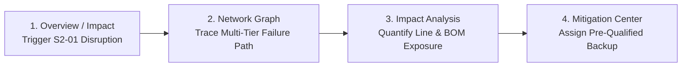
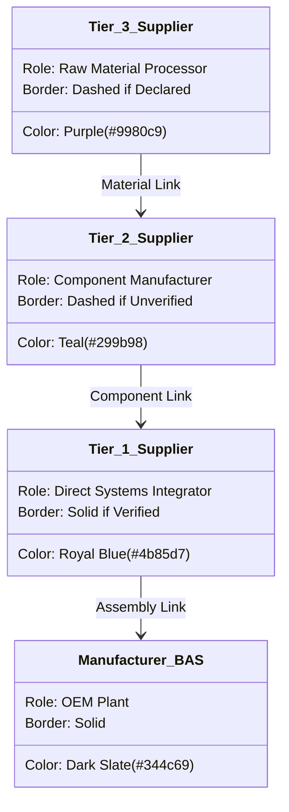
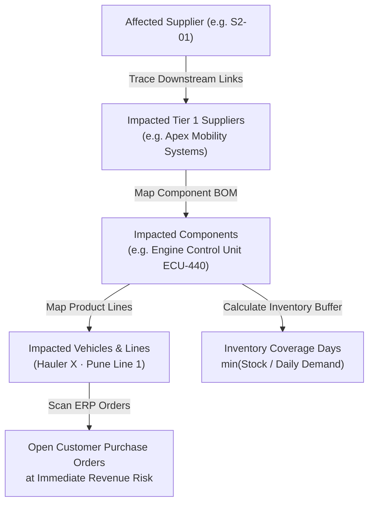

# SupplyLens: Multi-Tier Supply Chain Risk Intelligence & Disruption Mitigation

SupplyLens is the enterprise risk intelligence and multi-tier visibility platform in the Supply Chain Lab. It provides discrete manufacturing leaders—specifically automotive and industrial original equipment manufacturers (OEMs)—with deep visibility into sub-tier dependencies (Tier 1 through Tier 3+), transparent data verification, bill-of-materials (BOM) impact propagation, and structured alternative supplier mitigation workflows.

---

## 1. Executive Summary & Value Proposition

### The Problem: The Sub-Tier Blindspot
Modern manufacturing supply chains are deeply interconnected, yet most procurement and risk teams operate with significant blindspots:
- **77% of organizations lack visibility beyond Tier 1 suppliers** (McKinsey & Company research).
- **Over 80% of major supply chain disruptions originate in Tier 2 and Tier 3 suppliers**—the raw material processors, foundries, passive component fabricators, and specialized chemical synthesizers that Tier 1 suppliers depend upon.
- **Generic risk scoreboards fail operationally**: Traditional risk tools aggregate news sentiment or country macro-indices into abstract risk numbers (e.g., "Supplier X is 74/100"). These tools fail to answer critical manufacturing questions:
  1. *Which specific vehicle assembly line or finished product relies on this supplier?*
  2. *How many days of inventory buffer exist before assembly halts?*
  3. *Which customer purchase orders are at financial risk?*
  4. *What pre-qualified alternative suppliers exist with validated production capacity and tooling compatibility?*
- **Unverified self-assessments**: Procurement databases are frequently polluted with stale self-reported vendor questionnaires that lack proof of audit, certificates, or verifiable supply contracts.

### The Solution: BOM-Connected Risk Intelligence
SupplyLens transforms multi-tier mapping from an academic exercise into a practical operational control tower:
1. **Multi-Tier Graph Mapping**: Captures the complete upstream hierarchy from Tier 3 raw materials to Tier 2 sub-components, Tier 1 assemblies, and OEM manufacturing plants.
2. **Confidence-Weighted Data**: Distinguishes between **Verified** (backed by uploaded bills of lading, audit reports, or purchase orders), **Supplier Declared** (self-reported), and **Inferred** (statistical trade-lane flow) relationships.
3. **BOM & Inventory Propagation Engine**: Translates an upstream supplier disruption into operational downtime metrics—affected components, finished products, exposed production lines, customer order backlog, and exact days of inventory cover.
4. **Actionable Alternative Supplier Center**: Evaluates qualified backup suppliers by capacity, lead time, specification compatibility, and cost differential, enabling rapid procurement intervention.

---

## 2. The Quickest Manager Demonstration (4-Step Disruption Scenario)

To demonstrate the full business value of SupplyLens in under 3 minutes, follow this guided scenario:



### Step-by-Step Demo Script:
1. **Trigger Hypothetical Disruption (Step 1 of 4)**:
   - Navigate to **Overview** or **Impact analysis**.
   - Click the green **Run SupplyLens demo** (or **Simulate Tier 2 shutdown**) button.
   - This simulates a complete operational shutdown at **Orion Semiconductor** (`S2-01`), a Tier 2 supplier based in Hsinchu, Taiwan producing automotive-grade Microcontroller Units (MCU-32).
   - An alert banner activates: *"Scenario step 1/4 · Hypothetical shutdown active"*.
   - Click **Continue: network →**.

2. **Trace the Failure Path in the Network Graph (Step 2 of 4)**:
   - The interactive **Supplier network** tab opens.
   - The disrupted supplier (`S2-01`) is highlighted with a red alert badge and border.
   - The Bezier dependency link propagating downstream into Tier 1 supplier **Apex Mobility Systems** (`S1-01`) lights up in crimson red (`#e57464`).
   - Click on `S2-01` to view its inspection card: notice its risk score has jumped to **Critical (86/100)**.
   - In the header banner, click **Continue demo: trace impact →**.

3. **Quantify Operational Exposure & Inventory Runway (Step 3 of 4)**:
   - The **Impact analysis** tab opens, displaying real-time BOM propagation for `S2-01`:
     - **Affected Tier 1 Assemblies**: 1 (Apex Mobility Systems).
     - **Impacted Components**: Engine Control Unit (ECU-440).
     - **Impacted Finished Products**: Heavy Duty Hauler X, Commercial Van V2.
     - **Exposed Assembly Lines**: Pune Plant Line 1, Chennai EV Plant Line 2.
     - **Open Purchase Orders**: 4 active shipments under review.
     - **Inventory Run-Out Buffer**: **12 days of cover** (`min(inventory / dailyDemand)`).
   - Point out to the manager: *Without multi-tier mapping, the OEM would only discover this outage 12 days later when Line 1 shuts down.*
   - In the banner, click **Continue: mitigation →**.

4. **Execute Mitigation & Re-Route Procurement (Step 4 of 4)**:
   - The **Mitigation** tab opens, linking the active incident to qualified backup suppliers.
   - Review **Renesas Electronics** (`ALT-101`):
     - **Fit Score**: 92% match.
     - **Available Capacity**: 85,000 units/mo (exceeds monthly requirement).
     - **Lead Time**: 14 days (within critical buffer).
     - **Technical Compatibility**: Fully validated.
     - **Unit Cost Variance**: +4.5% premium.
   - Click **Assign procurement action** to formalize the dual-sourcing order.
   - The incident transitions to *"Mitigation in Progress"*, and the audit trail logs the procurement allocation.
5. **Reset**:
   - Click **Reset demo network** in the left navigation footer or Settings tab to return to the baseline state.

---

## 3. Side-Menu Guide (All 12 Tabs)

| Tab | Purpose & Business Use Case | How to Use & Workflow |
|---|---|---|
| **Overview** | **Executive Control Tower**: High-level health KPIs, priority exposure, risk distribution, and live audit feed. | Review network-wide metrics (total suppliers, high-risk counts, verified ratio). Click **Run SupplyLens demo** to start the scenario, or **Export summary CSV** to download executive reports. |
| **Supplier network** | **Multi-Tier Dependency Graph**: Interactive topological visualization of all Tier 1, 2, and 3 dependencies. | Pan, zoom, and drag nodes. Click any supplier node to inspect upstream sources, downstream consumers, materials, and verification confidence. Click **Add relationship** to map new multi-tier connections. |
| **Suppliers** | **Master Supplier Registry**: Searchable database of all 36 partner facilities across all tiers. | Filter by tier (`Tier 1`, `Tier 2`, `Tier 3`) or search by name, city, or material. Click any supplier row to open the full **Supplier Profile** dialog. Click **Add supplier** to register a new vendor. |
| **Risk monitoring** | **Early Warning & Signal Ingestion**: Tracks multi-category risk signals (operational, climate, financial, geopolitical, cyber). | Filter signals by category or severity. Click **Acknowledge** to assign a reviewer. Click **Investigate** to open an incident file, log notes, and adjust severity. |
| **Impact analysis** | **BOM & Operational Disruption Engine**: Translates supplier downtime into factory downtime, component shortages, and order risks. | Select any supplier from the dropdown. Review the 6 exposure cards (assemblies, components, vehicles, lines, orders, inventory cover days). View component stock runway and impacted customer purchase orders. |
| **Risk map** | **Geographic Footprint & Exposure**: Interactive global Leaflet map displaying facility locations and geographic hazard zones. | Filter by country, tier, risk tier, or category. Click on any colored circular marker to inspect local facility details, risk tier, and launch the full supplier dossier. |
| **Verification** | **Evidence-Based Trust Workspace**: Manages proof documents (audits, bills of lading, ISO certs) that upgrade supplier confidence. | Review verification rates by tier. Review pending relationships. Use **Request supplier update** or **Upload audit evidence** to upgrade an untrusted link to *Verified*. |
| **Incidents** | **Incident Response Center**: Master log of active and historical supply disruptions requiring formal investigation. | Track active incidents, assigned incident owners, evidence logs, and lifecycle status (*Investigating*, *Under Investigation*, *Mitigation in Progress*, *Resolved*). |
| **Mitigation** | **Contingency & Dual-Sourcing Center**: Matches disrupted components against pre-qualified alternative vendors. | Select a disrupted supplier to see qualified alternatives ranked by fit score. Inspect capacity, lead time, compatibility, and cost deltas. Click **Assign procurement action** to record a mitigation decision. |
| **Analytics** | **Performance & Pilot Metrics**: Quantitative breakdown of network risk by tier and enterprise pilot validation framework. | Monitor Tier 2+ visibility percentage, verification integrity, high-risk supplier share, and mitigation close rate. Review the target framework for enterprise pilot rollout. |
| **Reports & audit** | **Export Center & Governance History**: Seven specialized CSV exports and chronological change ledger. | Generate one-click CSV downloads for executive summaries, critical suppliers, geographic exposure, visibility gaps, incidents, and audit trails. |
| **Settings** | **Workspace Configuration & Controls**: Organization parameters, primary site, alerting thresholds, and data reset. | Set company name and primary facility. Toggle critical-only alerts. Use **Reset demo network** to restore original sample data. |

---

## 4. Deep Dive: The Supplier Network Graph

The **Supplier Network Graph** ([`components/supplylens/Network.tsx`](file:///d:/Project/supplychain/components/supplylens/Network.tsx)) is the centerpiece of SupplyLens. It visually maps how raw materials, sub-assemblies, and finished components flow into Bharat Automotive Systems (`BAS`).

```
[ Tier 3: Raw Materials ] ──> [ Tier 2: Sub-Assemblies ] ──> [ Tier 1: Major Systems ] ──> [ Manufacturer (BAS) ]
  • High-grade Steel (Purple)   • Microcontrollers (Teal)      • Wire Harnesses (Blue)        • Pune / Chennai Plant
  • Lithium Carbonate           • Stamped Chassis              • Brake Calipers
```

### Visual Encoding & Legend Reference



#### 1. Node Tier Placement (Columns)
- **Manufacturer (`BAS`)**: Fixed anchor at coordinate `x = 90, y = 350`.
- **Tier 1 Column**: Positioned at `x = 310` (Direct suppliers to the OEM).
- **Tier 2 Column**: Positioned at `x = 555` (Suppliers to Tier 1).
- **Tier 3 Column**: Positioned at `x = 800` (Raw material / sub-tier suppliers to Tier 2).
- Vertical spacing: Automatically distributed based on supplier count (`y = 55 + index * 61`).

#### 2. Node Border Colors
- **Manufacturer (`BAS`)**: Dark Slate (`#344c69`).
- **Tier 1**: Ocean Blue (`#4b85d7`).
- **Tier 2**: Deep Teal (`#299b98`).
- **Tier 3**: Royal Purple (`#9980c9`).
- **Selected Node**: Soft blue interior fill (`#e9f5fa`) with an emphasized 3px outer border.
- **Disrupted Scenario Node**: Crimson red border (`#e35d56`).
- **High-Risk Indicator**: A prominent red circular dot (`#e35d56`) renders immediately to the left of any supplier with High or Critical risk.

#### 3. Node Border Stroke Styles (Data Confidence)
- **Solid Stroke**: **Verified**. Backed by uploaded certificates, supplier audits, or validated customs records.
- **Dashed Stroke (`5 3`)**: **Supplier Declared**, **Pending Verification**, or **Outdated Information**. Self-reported data that has not yet been audited.

#### 4. Connecting Link (Edge) Styles
Cubic Bezier curves (`M x1,y1 C cx1,y1 cx2,y2 x2,y2`) represent material flow:
- **Solid Line**: **Verified Relationship** (documented supply agreement or delivery receipt).
- **Dashed Line (`8 4`)**: **Supplier Declared** or **Pending Verification** (reported in questionnaire but unverified).
- **Dotted Line (`3 5`)**: **Inferred Relationship** (predicted via trade pattern algorithms, customs data, or shipment matching).
- **Edge Highlighting**:
  - Unselected links remain muted slate (`#b8c5d3`, 1.5px).
  - Selecting a node highlights all upstream and downstream connections in bold teal (`#299b98`, 2.5px).
  - During an active disruption scenario, the affected path highlights in crimson red (`#e57464`, 2.8px).

---

### How to Operate the Network Graph

1. **Pan Across the Canvas**: Click and hold any blank area of the canvas and drag your mouse to reposition the network.
2. **Smooth Zooming**: Use your mouse scroll wheel to zoom continuously in and out.
3. **Zoom Controls (Top-Left)**:
   - **`+` (Zoom In)**: Multiplies magnification by $1.25\times$.
   - **`−` (Zoom Out)**: Multiplies magnification by $0.8\times$.
   - **`↺` (Reset View)**: Instantly restores the canvas to default pan coordinates and $1.0\times$ scale.
4. **Node Dragging**: Click and hold any supplier circle to move it around the canvas. All connecting Bezier curves stretch and adapt in real time.
5. **Path Tracing & Inspection**: Click on any node:
   - The graph dims all unrelated connections.
   - The selected supplier's full dependency trail (direct upstream vendors and downstream buyers) stays brightly highlighted.
   - The **Supplier Inspection Drawer** opens on the right side of the screen, showing the supplier's risk score, location, verification tier, materials provided, and direct dependencies.
6. **Editing Relationships**: Click **Add relationship** at the top right of the canvas to open the relationship editor. The system enforces logical adjacency (Tier 3 can only supply Tier 2; Tier 2 can only supply Tier 1; Tier 1 can only supply the OEM).

---

## 5. Comprehensive Button-by-Button Definition Directory

### Global & Header Controls
| Button / Control | Location | Exact Action & System Behavior |
|---|---|---|
| **Run SupplyLens demo** | Top bar / Overview | Initiates the 4-step guided disruption scenario on Tier 2 supplier `S2-01` (Orion Semiconductor). |
| **Reset demo network** | Left sidebar footer | Clears all browser modifications (`localStorage`) and resets the network, incidents, and audits to original factory seed records. |
| **Search suppliers...** | Global top bar | Filters the active view by supplier name, location, or component type. |
| **Simulated Data pill** | Global top bar | Indicates that all displayed records are illustrative prototype data. |

### Tab 1: Overview
| Button | Action |
|---|---|
| **Run SupplyLens demo** | Launches the guided disruption simulation. |
| **Export summary CSV** | Generates and downloads `supplylens-supplier-risk-summary.csv` containing all 36 supplier risk scores. |
| **View full network →** | Switches active view directly to the **Supplier network** graph. |
| **Manage incidents →** | Switches active view directly to the **Incidents** tracker. |
| **Open mitigation center →** | Switches active view directly to the **Mitigation** tab. |

### Tab 2: Supplier Network
| Button / Control | Action |
|---|---|
| **`+` (Zoom in)** | Increases SVG graph scale by 25%. |
| **`−` (Zoom out)** | Decreases SVG graph scale by 20%. |
| **`↺` (Reset zoom)** | Re-centers the SVG canvas and resets scale to identity ($1.0\times$). |
| **Continue demo: trace impact →** | Advances active scenario from Step 2 to Step 3 and opens **Impact analysis**. |
| **Add relationship** | Opens the **Relationship Editor** modal to link two suppliers. |
| **Edit supplier** | Opens the **Supplier Editor** modal for the currently selected node. |
| **View impact analysis →** | Sets the selected node as the target and switches to **Impact analysis**. |
| **Find supplier (input)** | Live text search filtering visible nodes on the canvas. |
| **Filter by tier (dropdown)** | Filters canvas nodes to `All`, `Tier 1`, `Tier 2`, or `Tier 3`. |

### Tab 3: Suppliers (Master Registry)
| Button / Control | Action |
|---|---|
| **Add supplier** | Opens the **Supplier Editor** modal in "New Supplier" mode. |
| **Export CSV** | Downloads the complete supplier registry as a CSV spreadsheet. |
| **Tier filter buttons** | Filters table rows by `All`, `Tier 1`, `Tier 2`, or `Tier 3`. |
| **Search suppliers (input)** | Instant text filter across supplier names, cities, and materials. |
| **Supplier row click** | Opens the comprehensive **Supplier Profile** modal dialog. |

### Tab 4: Risk Monitoring
| Button / Control | Action |
|---|---|
| **Category filter dropdown** | Filters risk signals by Operational, Geographic/Climate, Financial, Geopolitical, or Cyber. |
| **Severity filter dropdown** | Filters signals by Critical, High, Medium, or Low. |
| **Acknowledge** | Marks a signal as *Under Investigation* and assigns a review owner (Priya Sharma). |
| **Investigate** | Opens the **Incident Investigation Dialog** to log field findings, change severity, and update status. |
| **Status dropdown (table)** | In-place update of incident state (*New*, *Under Investigation*, *Mitigation in Progress*, *Resolved*). |
| **Owner dropdown (table)** | In-place reassignment of incident team member. |

### Tab 5: Impact Analysis
| Button / Control | Action |
|---|---|
| **Target supplier dropdown** | Selects any of the 36 suppliers to recalculate upstream/downstream BOM exposure. |
| **Simulate Tier 2 shutdown** | Immediately triggers an operational outage on the selected supplier. |
| **Continue: network →** | Advances scenario from Step 1 to Step 2 and opens the network graph. |
| **Continue: mitigation →** | Advances scenario from Step 3 to Step 4 and opens the mitigation center. |
| **Open mitigation center →** | Jumps directly to **Mitigation** with the current supplier pre-selected. |

### Tab 6: Risk Map
| Button / Control | Action |
|---|---|
| **Country filter** | Filters map pins by geographic country (India, Taiwan, Germany, Japan, USA, etc.). |
| **Tier filter** | Filters map pins by `All`, `Tier 1`, `Tier 2`, or `Tier 3`. |
| **Risk filter** | Filters map pins by `All`, `Critical`, `High`, `Medium`, or `Low`. |
| **Category filter** | Filters map pins by underlying risk driver. |
| **Map Marker Click** | Centers map on site and opens the detailed **Supplier Profile Dialog** above the map. |

### Tab 7: Verification Workspace
| Button / Control | Action |
|---|---|
| **Request supplier update** | Simulates sending an automated digital questionnaire and audit request to the vendor. |
| **Upload audit evidence** | Opens document attachment prompt to link third-party audit reports or bills of lading. |
| **Verify relationship** | Transitions an unverified connection to *Verified* status once evidence is attached. |

### Tab 8: Incidents
| Button / Control | Action |
|---|---|
| **Filter by status** | Toggles between *All*, *Active*, and *Resolved* incident logs. |
| **Incident row click** | Opens the incident investigation log with root cause notes and evidence references. |

### Tab 9: Mitigation Center
| Button / Control | Action |
|---|---|
| **Disrupted supplier selector** | Selects which active supplier failure to evaluate backup options for. |
| **Assign procurement action** | Formally commits the emergency purchase order to the selected alternative supplier. |
| **Mark Action Complete** | Closes out an active mitigation task in the action tracking table. |

### Tab 10: Reports & Audit
| Button / Control | Action |
|---|---|
| **Export supplier CSV** | Downloads master supplier directory CSV. |
| **Download CSV (7 cards)** | Individual download buttons for each of the 7 enterprise reports:
1. *Supplier risk summary*
2. *Critical supplier report*
3. *Multi-tier visibility report*
4. *High-risk geographical exposure*
5. *Open incident report*
6. *Mitigation action report*
7. *Supplier verification report* |

### Tab 11: Settings
| Button / Control | Action |
|---|---|
| **Save settings** | Persists company profile changes and notification thresholds to local browser storage. |
| **Reset SupplyLens demo data** | Restores all 36 suppliers, 45 relationships, and incident states to clean defaults. |

---

## 6. Risk Scoring & Impact Propagation Models

SupplyLens implements transparent, rule-based algorithms rather than opaque black-box machine learning models:

### 1. 100-Point Risk Score Model (`scoreFor`)
A supplier's composite risk score is calculated across six weighted operational dimensions:

$$\text{Composite Risk} = S_{\text{ops}} + S_{\text{geo}} + S_{\text{dep}} + S_{\text{ver}} + S_{\text{crit}} + S_{\text{alt}}$$

| Risk Factor | Max Points | Evaluation Logic |
|---|---|---|
| **Operational Signals** ($S_{\text{ops}}$) | **35 pts** | Active unmitigated incidents, port delays, factory fires, labor disputes. |
| **Geographic Concentration** ($S_{\text{geo}}$) | **15 pts** | Extreme weather exposure, seismic hazard zones, geopolitical trade friction. |
| **Dependency Concentration** ($S_{\text{dep}}$) | **15 pts** | Single-source dependency where downstream tiers have no secondary supplier. |
| **Verification Completeness** ($S_{\text{ver}}$) | **15 pts** | Penalizes unverified or outdated self-declarations (Inferred = 15, Outdated = 12, Declared = 8, Verified = 0). |
| **Material Criticality** ($S_{\text{crit}}$) | **10 pts** | Criticality score of the specific material (e.g., semiconductors vs. commodity fasteners). |
| **Qualified Alternatives Gap** ($S_{\text{alt}}$) | **10 pts** | Lack of an identified, pre-qualified backup supplier in the database. |

#### Severity Classifications:
- **Critical Risk**: Score $\ge 75$ (Immediate executive escalation).
- **High Risk**: Score $50 - 74$ (Active procurement review).
- **Medium Risk**: Score $30 - 49$ (Routine monitoring).
- **Low Risk**: Score $< 30$ (Normal operations).

---

### 2. Multi-Tier BOM Impact Propagation (`impactFor`)
When an upstream supplier is compromised, SupplyLens executes a breadth-first search (BFS) downstream through the network graph to evaluate factory-floor exposure:



#### Inventory Runway Formula:
$$\text{Days of Inventory Cover} = \min_{c \in \text{Components}} \left\lfloor \frac{\text{Current Finished \& On-Hand Buffer Stock}_c}{\text{Daily Plant Demand Rate}_c} \right\rfloor$$

If on-hand inventory is 3,600 units and daily assembly line demand is 300 units, the system flags exactly **12 days of cover** before assembly line stoppage occurs.

---

### 3. Alternative Supplier Qualification (`alternativeFit`)
When reviewing alternative suppliers in the **Mitigation** tab, options are ranked using an objective compatibility index:
- **Available Production Capacity**: Must satisfy $\ge 100\%$ of OEM monthly run rate.
- **Lead Time Window**: Must be shorter than or equal to the remaining inventory buffer days.
- **Specification Compatibility**: Form-factor, voltage, thermal, and material tolerances must match existing engineering drawings.
- **Landed Cost Delta**: Quantifies premium/discount per unit relative to contract baseline.

---

## 7. Data Confidence & Verification Hierarchy

SupplyLens directly tackles "survey fatigue" and inaccurate supplier self-reporting by enforcing four distinct levels of data confidence:

```
[ Tier A: Verified ]              <-- Backed by physical audit or Bill of Lading (Solid line)
      ▲
[ Tier B: Supplier Declared ]     <-- Self-reported in vendor questionnaire (Dashed line)
      ▲
[ Tier C: Inferred ]              <-- Derived from trade flows & customs algorithms (Dotted line)
      ▲
[ Tier D: Outdated Information ]  <-- Unconfirmed for > 12 months (Dashed with warning)
```

1. **Verified**: The connection has been confirmed through third-party supply chain audits, active ERP purchase order linkages, or verified customs declarations. Displayed with a solid stroke.
2. **Supplier Declared**: The supplier submitted the information in a digital questionnaire, but supporting documentation has not yet been audited. Displayed with a dashed stroke.
3. **Pending Verification**: Evidence has been submitted by the vendor and is currently queued for human compliance review.
4. **Inferred**: The relationship is statistically deduced from maritime shipping manifests, export declarations, or industry bill-of-materials benchmarks. Displayed with a dotted stroke.
5. **Outdated Information**: Relationships where verification has lapsed beyond 12 months without re-certification.

---

## 8. Enterprise Pilot Implementation Plan

Based on research benchmarks across industrial and automotive manufacturing leaders, a structured 12-week pilot deployment is recommended:

```
Week 1 - 4: Discovery & Critical BOM Mapping
  ├── Identify top 3 revenue-critical product families (e.g., Heavy Commercial Vehicles)
  ├── Extract Tier 1 supplier master records from SAP/Oracle ERP
  └── Map Tier 2 and Tier 3 dependencies for top 20 critical components

Week 5 - 8: Multi-Tier Verification & Incident Ingestion
  ├── Deploy digital verification requests to top 50 sub-tier suppliers
  ├── Ingest third-party risk feeds (weather, port congestion, trade compliance)
  └── Establish evidence-attachment baseline for verified relationships

Week 9 - 12: Disruption Simulation & Sourcing Playbooks
  ├── Execute table-top disruption simulations with procurement teams
  ├── Pre-qualify secondary suppliers for identified single-source vulnerabilities
  └── Benchmark Alert-to-Action response time against historical baseline
```

---

## 9. Prototype Realities: What is Real vs. Simulated

To set accurate expectations with leadership and technical reviewers:

### What is Operationally Functional in this Prototype:
- **Interactive Multi-Tier Graph**: Fully operational D3.js vector engine supporting drag-and-drop node positioning, dynamic Bezier curve recalculation, canvas panning, continuous zooming, and path-isolation highlighting.
- **BOM & Impact Propagation Engine**: Dynamically traces any supplier outage down through connected Tier 1 assemblies, bill-of-materials components, vehicle assembly lines, and customer purchase orders.
- **Inventory Cover Calculation**: Computes actual days of inventory cover based on component buffer quantities and daily burn rates.
- **Dual-Sourcing Evaluation**: Real-time evaluation of backup suppliers against capacity, lead time, specification compatibility, and cost variances.
- **Seven CSV Export Generators**: Produces real, downloadable CSV data reports for executive briefings and audits.
- **Local Persistence & State Management**: Retains all edits, new suppliers, updated relationships, and acknowledged incidents in browser storage (`localStorage`).

### What is Simulated for Demonstration:
- **Mock External APIs**: News sentiment, weather forecasts, and port congestion alerts are simulated demonstration records rather than live paid feeds.
- **ERP Integration**: Production line schedules and customer purchase orders are representative models rather than live SAP/Oracle connections.
- **Document OCR**: Uploading audit evidence records the file reference locally rather than executing server-side OCR parsing.

---

## 10. Local Setup & Execution

To run SupplyLens locally in your browser:

1. Clone or navigate to the repository directory:
   ```bash
   cd d:\Project\supplychain
   ```
2. Install project dependencies:
   ```bash
   npm install
   ```
3. Start the Next.js development server:
   ```bash
   npm run dev
   ```
4. Open your browser and navigate to:
   ```
   http://localhost:3000/supplylens
   ```
5. Click **Run SupplyLens demo** in the top navigation bar to begin the guided executive walkthrough.